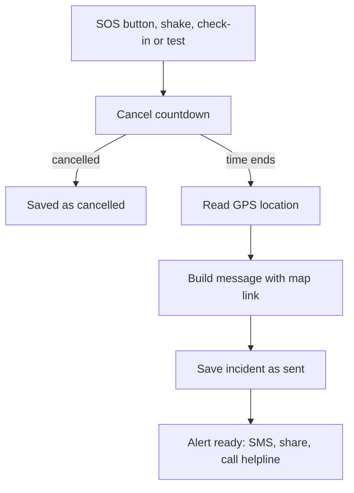

<div align="center">

# SafeWalk

**One tap or one shake to alert the people you trust.**

A sensor-based personal safety app built with Flutter, with GPS location sharing, a cancel countdown and an alert history.


*Mobile Application Development semester project, COMSATS University Islamabad*

</div>

---

## DEMO

<!--
OPTIONAL: to play the video directly inside this page instead of linking to it,
click the pencil (Edit) button on GitHub, drag DEMO.mp4 into the editor, and
paste the link GitHub creates on its own line here.
-->

### [▶ Watch the DEMO video](DEMO.mp4)

---

## Why SafeWalk?

In an emergency there is no time to unlock a phone, open a messaging app and type a location. SafeWalk reduces that to **one action**. A short cancel countdown protects against accidental alerts, and the message always includes your location.

## Features

| Feature | What it does |
|---------|--------------|
| **SOS button** | A large pulsing button that starts the alert flow |
| **Shake to alert** | Three hard shakes within two seconds trigger an alert (accelerometer) |
| **Cancel countdown** | 3 to 15 seconds to tap "I'm safe" and stop a false alarm |
| **GPS location** | Current position as a Google Maps link, with a last-known fallback |
| **Emergency contacts** | Add, edit, delete and star contacts, stored in SQLite |
| **Send the alert** | SMS to all contacts or one person, share through any app, call a contact |
| **Helpline shortcuts** | One-tap dialer for Rescue 1122 and Police 15 |
| **Safe check-in** | Set a timer; if you do not confirm you are safe, an alert starts |
| **Fake call** | A realistic incoming call to leave an uncomfortable situation |
| **Alert history** | Time, trigger, location and status, with a false-alarm rate |
| **Settings** | Light, dark or auto theme, sensitivity slider, countdown length, custom message |
| **Live sensor meter** | See the accelerometer reading and threshold to calibrate shake detection |

## How it works



### Shake detection

The three accelerometer axes are combined into one number:

```
magnitude = sqrt(x² + y² + z²)
```

A phone at rest reads about **9.81 m/s²** (gravity). A reading above the **threshold (default 28)** counts as one hit, and **3 hits within 2 seconds** start the alert. A short debounce stops one shake from being counted twice. The core logic is in [`lib/services/shake_detector.dart`](lib/services/shake_detector.dart) and is covered by unit tests.

## Tech stack

| Area | Technology |
|------|------------|
| Framework | Flutter and Dart |
| State management | Provider (`ChangeNotifier`) |
| Local database | SQLite via `sqflite` |
| Settings | `shared_preferences` |
| Sensors | `sensors_plus` |
| Location | `geolocator` |
| Calls, SMS, maps | `url_launcher` |
| Sharing | `share_plus` |

## Project structure

```
lib/
├── main.dart              App start, providers, SOS overlay
├── core/                  Theme, constants, helpers
├── models/                EmergencyContact, Incident
├── data/                  SQLite helper
├── services/              Shake detector, location, alerts
├── providers/             SOS, check-in, contacts, history, settings
├── screens/               Home, contacts, history, settings, SOS overlay, fake call
└── widgets/               SOS button, soft card, sensor meter
test/                      Unit tests for the shake algorithm
docs/                      Project report and notes
DEMO.mp4                   Demo video
```

## Getting started

### Requirements
- [Flutter SDK](https://docs.flutter.dev/get-started/install) (stable) and the Android SDK
- A **physical Android phone** with USB debugging on (sensors, GPS and SMS cannot be tested on an emulator)

### Run the app

```bash
git clone https://github.com/maimoonaamjid/safewalk.git
cd safewalk
flutter pub get
flutter devices
flutter run
```

### Android permissions

Make sure `android/app/src/main/AndroidManifest.xml` contains the location permissions and the `<queries>` block for SMS, phone and web links. The exact lines are in [`docs/android_manifest_additions.txt`](docs/android_manifest_additions.txt). Without them, location and the SMS and call buttons will not work.

### Run the tests

```bash
flutter test
```

## Limitations

- **The user presses Send.** SafeWalk opens the SMS app with the message ready. Fully automatic sending needs the SEND_SMS permission, which Google Play restricts to default SMS apps and approved use cases.
- **Foreground only.** Shake detection and the check-in timer work while the app is running, not as a guaranteed background service.
- **GPS indoors** can be slow or inaccurate; the app falls back to the last known position.
- **Android only.** iOS is not supported.
- **Shake threshold** may need tuning on different phones. Use the live sensor meter in Settings.

## Roadmap

- [ ] Foreground service so shake detection works with the screen off
- [ ] Contact picker from the phone's address book
- [ ] Battery level and live location sharing in the alert
- [ ] Urdu and English language support
- [ ] Cloud backup of contacts
- [ ] Widget and integration tests
- [ ] iOS support

## Project report

The full report with design diagrams, testing and references is in [`docs/SafeWalk_Project_Report.pdf`](docs/SafeWalk_Project_Report.pdf).

## Team

| Member | Responsibility |
|--------|----------------|
| Maimoona Amjid | UI/UX design, SOS and fake call screens |
| Danyal Ali | Emergency contacts, permissions, local database |
| Muhammad Adil Zahid | Shake detection and threshold testing |
| Kamil Khan | Location, alert message, sending logic |
| Wajahat Hussain | Check-in timer, notifications, testing, documentation |

**Course:** Mobile Application Development, BSE-5B, COMSATS University Islamabad
**Instructor:** Sir Muhammad Javed Raza

## Disclaimer

SafeWalk is an academic project and a helper tool. It does not replace emergency services. In a real emergency, always contact the official helplines.

## Acknowledgements

- [Flutter documentation](https://docs.flutter.dev)
- [Android motion sensors guide](https://developer.android.com/develop/sensors-and-location/sensors/sensors_motion)
- [Material Design 3](https://m3.material.io)
